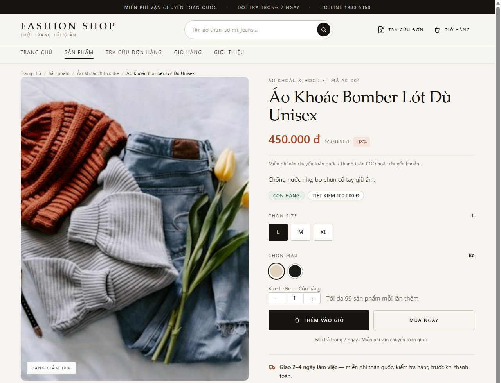
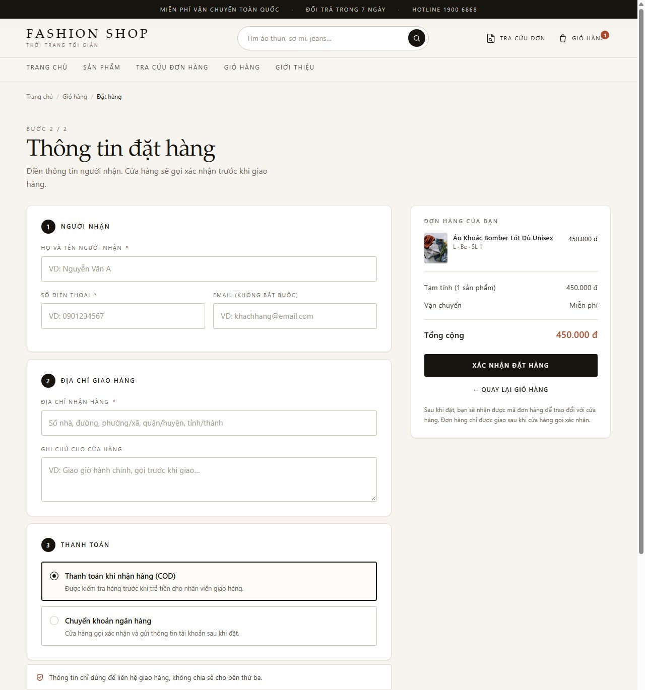
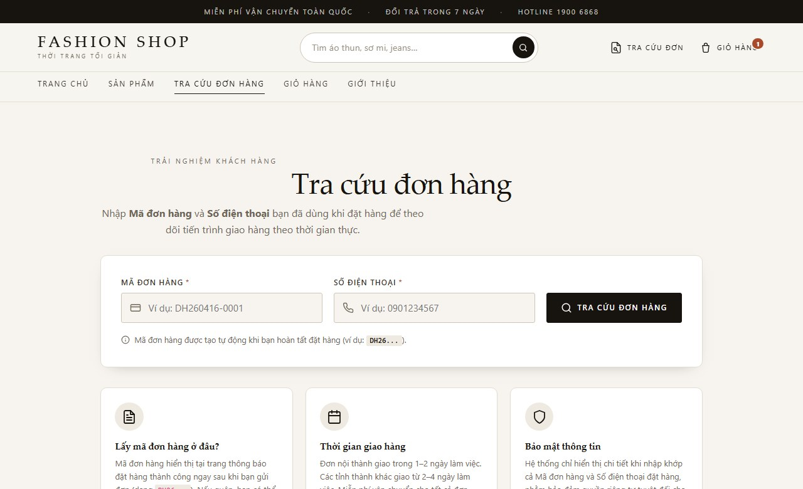
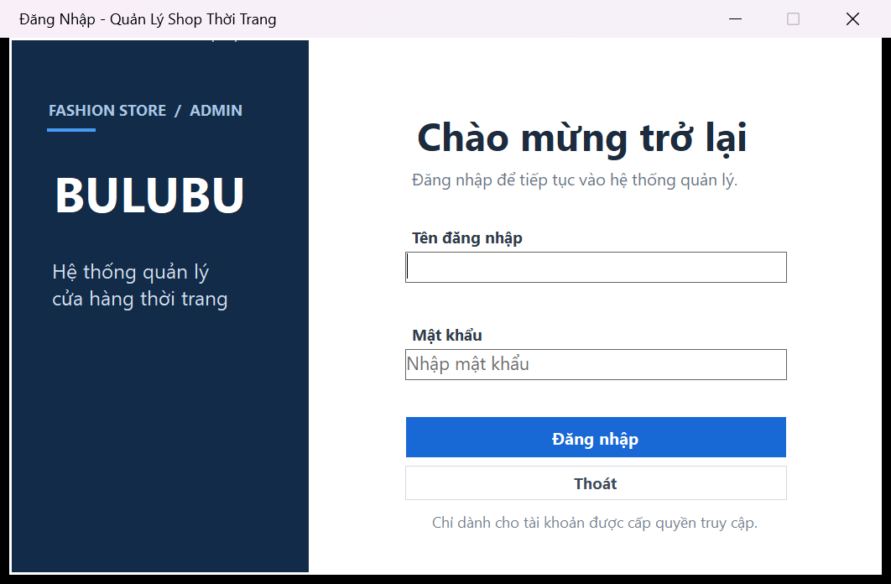
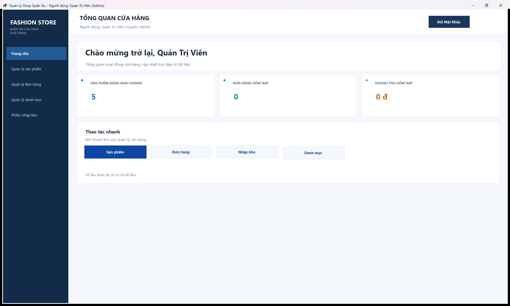
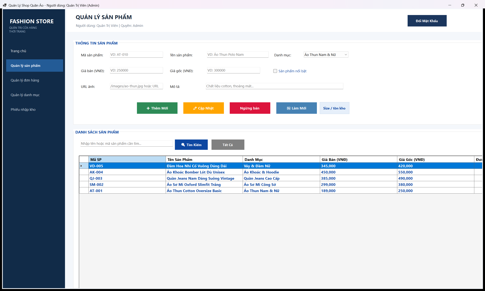
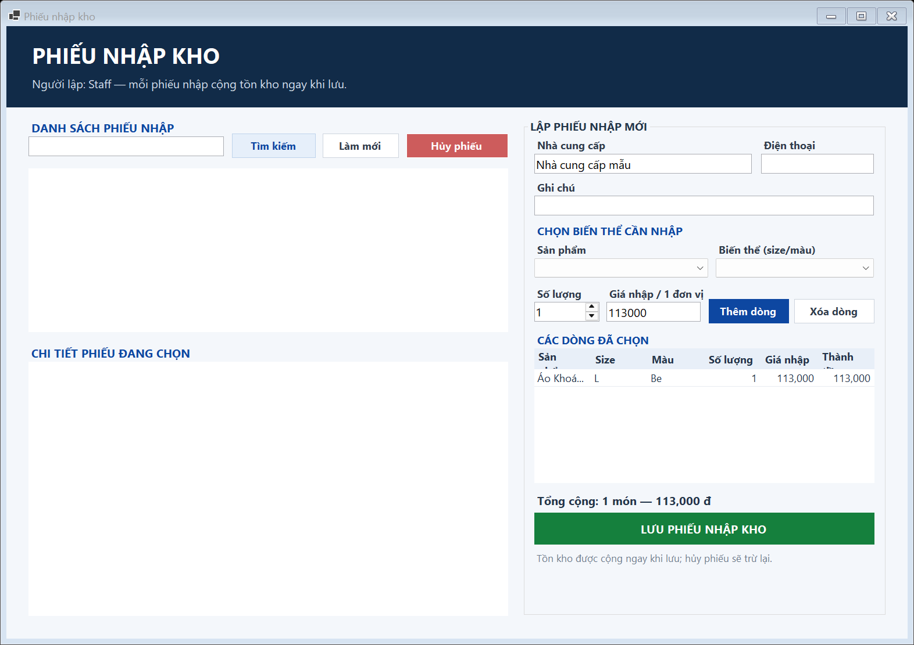

# Hướng dẫn sử dụng Fashion Shop

Khách mua hàng và theo dõi đơn trên website. Quản trị viên (Admin) và nhân viên (Staff) dùng ứng dụng Windows để theo dõi cửa hàng, xử lý đơn và nhập kho. Đơn đặt trên web xuất hiện trong mục **Quản lý đơn hàng** của ứng dụng Windows vì hai ứng dụng dùng chung dữ liệu.

- [Khởi động bản demo](#khởi-động-bản-demo)
- [Mua hàng trên website](#mua-hàng-trên-website)
- [Vận hành cửa hàng trên Windows](#vận-hành-cửa-hàng-trên-windows)
- [Xử lý lỗi thường gặp](#xử-lý-lỗi-thường-gặp)

## Khởi động bản demo

Nếu chạy lần đầu, hãy hoàn tất [cài đặt cơ sở dữ liệu và cấu hình môi trường](../../README.md#2-cài-đặt-lần-đầu-máy-mới-clone-repo). Từ thư mục gốc dự án, chạy từng ứng dụng trong một cửa sổ PowerShell riêng.

| Ứng dụng | Cách mở |
| --- | --- |
| Website dành cho khách | Chạy `.\run-web.cmd` rồi mở `http://localhost:5193` |
| Phần mềm dành cho Admin và Staff | Chạy `.\run-desktop.cmd` để mở cửa sổ đăng nhập |

## Mua hàng trên website

### Tìm và chọn sản phẩm

1. Mở **Sản phẩm**. Tìm theo tên hoặc mã, chọn danh mục nếu cần. Dùng thanh phân trang bên dưới danh sách để xem thêm kết quả.
2. Mở sản phẩm để xem ảnh, giá và tình trạng hàng. Chọn size, màu và số lượng. Nếu tổ hợp đã hết hàng hoặc chưa có sẵn, hãy chọn size hoặc màu khác.
3. Bấm **Thêm vào giỏ** để tiếp tục mua sắm, hoặc **Mua ngay** để chuyển đến bước nhập thông tin đặt hàng.

### Kiểm tra giỏ và đặt hàng

1. Mở **Giỏ hàng** để kiểm tra sản phẩm, size, màu và số lượng. Chỉnh số lượng rồi bấm **Cập nhật**, hoặc bấm **Xóa** ở món muốn bỏ.
2. Bấm **Tiến hành đặt hàng**. Điền họ tên người nhận, số điện thoại bắt đầu bằng `0` và gồm 10–11 chữ số, cùng địa chỉ giao hàng. Có thể điền thêm email và ghi chú giao hàng.
3. Chọn **Thanh toán khi nhận hàng (COD)** hoặc **Chuyển khoản ngân hàng**. Kiểm tra lại tổng tiền rồi bấm **Xác nhận đặt hàng**.
4. Khi trang **Đặt hàng thành công** xuất hiện, bấm **Sao chép** để lưu mã đơn. Giữ mã đơn cùng số điện thoại đã dùng để tra cứu sau.

### Tra cứu đơn hàng

1. Mở **Tra cứu đơn hàng** từ menu, hoặc bấm **Tra cứu tiến trình đơn hàng** trên trang đặt hàng thành công.
2. Nhập **Mã đơn hàng** và **Số điện thoại** đã dùng để đặt hàng. Bấm **Tra cứu đơn hàng** để xem tiến trình giao hàng và thông tin thanh toán.
3. Nếu mục **Lịch sử đơn hàng trên thiết bị này** xuất hiện, bấm **Xem nhanh** để tra cứu lại. Khi dùng thiết bị chung, có thể bấm **Xóa lịch sử** để xóa các mục đã lưu trên trình duyệt.

## Vận hành cửa hàng trên Windows

### Đăng nhập và xem quyền

Nhập tên đăng nhập và mật khẩu được cấp, bấm **Đăng nhập**, rồi xác nhận thông báo. Trên cơ sở dữ liệu mẫu, tài khoản `admin` có quyền Admin và `nhanvien` có quyền Staff. Mật khẩu ban đầu của cả hai tài khoản mẫu là `123456`.

| Thao tác | Admin | Staff |
| --- | --- | --- |
| Xem tổng quan, tìm sản phẩm, đổi mật khẩu cá nhân | Có | Có |
| Quản lý đơn hàng và xác nhận thanh toán | Có | Có |
| Lập phiếu nhập kho và xem phiếu | Có | Có |
| Thêm, cập nhật, ngừng bán sản phẩm và sửa biến thể size, màu | Có | Cần Admin |
| Quản lý danh mục và hủy phiếu nhập kho | Có | Cần Admin |

### Đọc số liệu tổng quan và đổi mật khẩu

Chọn **Trang chủ** để xem số sản phẩm đang kinh doanh, số đơn hàng hôm nay và doanh thu hôm nay. Doanh thu được tính từ đơn đặt hôm nay đã hoàn thành hoặc đã thanh toán, trừ các đơn đã hủy.

Để đổi mật khẩu cá nhân, bấm **Đổi Mật Khẩu**, nhập mật khẩu hiện tại, mật khẩu mới và phần xác nhận. Dùng mật khẩu mới có ít nhất 8 ký tự, khác mật khẩu hiện tại và không có dấu cách ở đầu hoặc cuối. Bấm **Đổi mật khẩu** trong hộp thoại để lưu. Bấm **Đăng Xuất** ở cửa sổ quản lý khi kết thúc ca làm việc.

### Quản lý danh mục và sản phẩm

Admin mở **Quản lý danh mục** để nhập tên, mô tả và bấm **Thêm danh mục**. Để sửa, chọn danh mục trong bảng, chỉnh thông tin rồi bấm **Cập nhật**. Nút **Ngừng hoạt động** hoặc **Kích hoạt lại** thay đổi trạng thái của danh mục đang chọn.

Trong **Quản lý sản phẩm**, cả hai vai trò có thể tìm theo tên hoặc mã. Admin có thể thực hiện các thao tác sau.

1. Để thêm sản phẩm, điền mã, tên, danh mục và giá bán, rồi bấm **Thêm Mới**. Có thể nhập thêm mô tả, URL ảnh, giá gốc và đánh dấu **Sản phẩm nổi bật**. Nếu nhập giá gốc, dùng mức giá bằng hoặc cao hơn giá bán.
2. Để sửa, chọn sản phẩm trong bảng, đổi thông tin và bấm **Cập Nhật**. Để dừng bán, chọn sản phẩm, bấm **Ngừng bán** rồi xác nhận. Sản phẩm ngừng bán được gỡ khỏi danh sách bán trên website.
3. Để thêm hoặc sửa size và màu, chọn sản phẩm rồi bấm **Size / tồn kho**. Trong cửa sổ biến thể, nhập size và màu rồi chọn **Thêm biến thể**, hoặc chọn dòng có sẵn và bấm **Cập nhật** sau khi sửa. Biến thể mới có tồn kho bằng 0. Dùng phiếu nhập kho để đưa hàng vào kho.

### Lập và hủy phiếu nhập kho

1. Mở **Phiếu nhập kho**. Trong phần **Lập phiếu nhập mới**, điền thông tin nhà cung cấp và ghi chú nếu cần.
2. Chọn sản phẩm và biến thể size, màu. Nhập số lượng nhận và giá nhập cho một đơn vị, rồi bấm **Thêm dòng**. Nếu cần sửa một dòng, chọn **Xóa dòng** rồi thêm lại.
3. Kiểm tra danh sách đã chọn và tổng tiền, rồi bấm **LƯU PHIẾU NHẬP KHO**. Hệ thống cộng tồn ngay khi lưu thành công.
4. Để xem phiếu cũ, tìm theo mã phiếu hoặc tên nhà cung cấp và chọn phiếu trong bảng. Để hủy, Admin chọn phiếu rồi bấm **Hủy phiếu** và xác nhận. Hệ thống trừ lại số lượng đã nhập nếu tồn kho hiện tại đủ cho tất cả các dòng trong phiếu.

### Xử lý đơn hàng

1. Mở **Quản lý đơn hàng**. Có thể lọc theo trạng thái và tìm bằng mã đơn, tên khách hoặc số điện thoại.
2. Chọn dòng đơn rồi bấm **Xem chi tiết** để kiểm tra mặt hàng và số lượng trước khi xử lý.
3. Chọn **Trạng thái tiếp theo**, bấm **Cập nhật trạng thái** rồi xác nhận. Luồng giao hàng là **Chờ xử lý → Đã duyệt → Đang giao → Hoàn thành**.
4. Khi khách đã thanh toán và cần ghi nhận trước khi hoàn thành đơn, chọn đơn rồi bấm **Xác nhận đã TT** và đọc thông báo xác nhận. Khi đơn chuyển sang **Hoàn thành**, hệ thống tự ghi nhận đã thanh toán.

Nếu khách hủy trước khi đơn chuyển sang **Đang giao**, chọn **Đã hủy** ở bước cập nhật. Hệ thống hoàn tồn về đúng biến thể và xóa trạng thái đã thanh toán của đơn. Nếu đơn đã thu tiền, xử lý khoản tiền với khách theo thỏa thuận của cửa hàng.

## Xử lý lỗi thường gặp

| Tình huống | Cách xử lý |
| --- | --- |
| Bản demo báo lỗi kết nối hoặc website không tải được dữ liệu | Kiểm tra Docker Desktop, trạng thái SQL Server, cấu hình `.env` và cổng kết nối theo [hướng dẫn cài đặt](../../README.md#2-cài-đặt-lần-đầu-máy-mới-clone-repo), rồi mở lại ứng dụng. |
| Giỏ báo số lượng vượt tồn | Giảm số lượng, đổi size hoặc màu, hoặc xóa món đã hết hàng trước khi đặt lại. |
| Tra cứu không tìm thấy đơn | Kiểm tra mã trên trang xác nhận và số điện thoại đặt hàng. Nhập lại cả hai giá trị rồi tra cứu. |
| Ứng dụng Windows báo **Không đủ quyền** | Kiểm tra vai trò trên thanh tiêu đề. Nhờ Admin thực hiện các thao tác dành riêng cho Admin. |
| Không thêm được dòng nhập kho | Kiểm tra biến thể đã chọn, giá nhập lớn hơn 0 và biến thể chưa có trong phiếu. |
